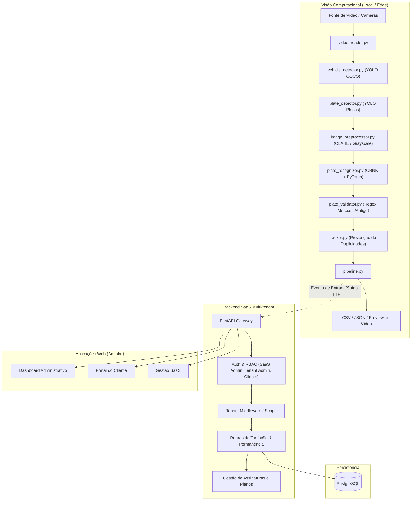

# Arquitetura do Sistema — SaaS de Gestão de Estacionamentos com ALPR

## 1. Visão Geral

A plataforma foi projetada como um SaaS (Software as a Service) multi-tenant com foco em automação de estacionamentos através de visão computacional (ALPR).

O sistema opera de forma modular e desacoplada em 5 camadas principais:
1. **Módulo de Visão Computacional (ALPR Engine)**: Aquisição, detecção de veículos/placas, OCR com CRNN e rastreamento de passagens.
2. **Backend API REST (FastAPI)**: Regras de negócio, tarifação, controle de permanência, assinaturas e isolamento multi-tenant.
3. **Persistência de Dados (PostgreSQL + SQLAlchemy + Alembic)**: Banco de dados relacional com integridade referencial e auditoria.
4. **Frontend Web (Angular + TypeScript + SCSS)**: Painel administrativo para gestores de estacionamentos e portal de autoatendimento para clientes.
5. **Infraestrutura e Deploy (Docker & Docker Compose)**: Orquestração de containers, compatível com Apple Silicon (MPS) e CPU/CUDA.

---

## 2. Diagrama de Fluxo e Componentes

---

## 3. Módulos Detalhados

### 3.1. Visão Computacional (ALPR)
- **Desacoplamento estrito**: O módulo de visão computacional opera de forma 100% autônoma para processamento offline de arquivos de vídeo, gerando métricas, vídeos anotados e relatórios CSV/JSON.
- **Pipeline em 2 estágios de detecção**:
  - Estágio 1: Detecção do veículo (`car`, `truck`, `bus`) para delimitar a ROI (Region of Interest) e reduzir falsos positivos em áreas estáticas de fundo.
  - Estágio 2: Detecção especializada de placas na ROI do veículo.
- **OCR com CRNN**: Rede Convolucional Recorrente treinada para leitura sequencial de caracteres em placas, com decodificação CTC.
- **Validação de Sintaxe**: Padrões brasileiros (Antigo: `[A-Z]{3}[0-9]{4}`; Mercosul: `[A-Z]{3}[0-9][A-Z][0-9]{2}`).
- **Rastreamento e Anti-Duplicidade**: Algoritmo de persistência temporal (IoU + centróide) que consolida múltiplas passagens do mesmo veículo em um único evento com voting de caracteres.

### 3.2. Backend Multi-tenant
- **Isolamento de Dados**: Toda entidade operacional pertence a um `estacionamento_id`. Todas as consultas são filtradas pelo contexto do tenant autenticado.
- **Perfis de Acesso (RBAC)**:
  - `SAAS_ADMIN`: Gestão de empresas contratantes, planos globais da plataforma e métricas de faturamento global.
  - `ESTACIONAMENTO_ADMIN`: Gestão operacional do estacionamento (clientes, veículos, tarifas, câmeras, movimentações e cobranças manuais).
  - `CLIENTE`: Consulta restrita aos seus veículos cadastrados, histórico de acessos, cobranças e assinaturas.
- **Motor de Tarifação**:
  - Tarifas avulsas (hora adicional, fração, diária).
  - Planos contratados (mensal/anual com descontos pré-definidos).
  - Verificação automática de planos ativos antes de gerar cobrança avulsa.

---

## 4. Requisitos de Execução e Compatibilidade
- **Hardware**: Suporte nativo a arquiteturas ARM64 (Apple Silicon com aceleração via `mps`) e x86_64 (Linux/Windows com `cpu` ou `cuda`).
- **Python**: Versão 3.12 com dependências congeladas e gerenciamento via ambiente virtual.
