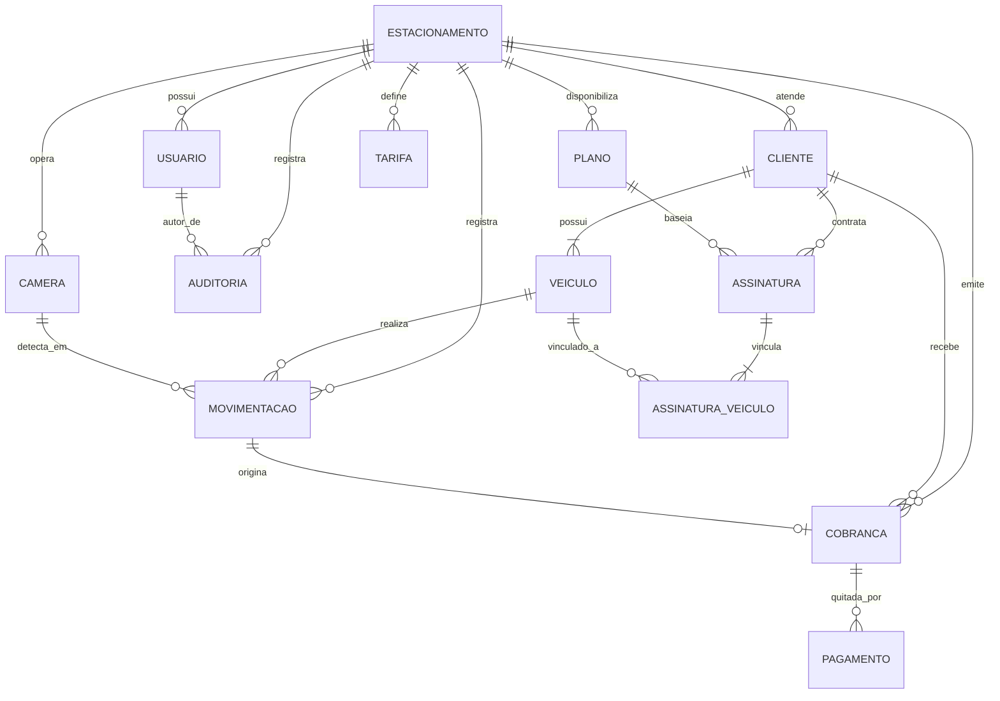

# Modelagem do Banco de Dados — SaaS de Estacionamentos ALPR

## 1. Visão Geral da Modelagem

O banco de dados relacional utiliza PostgreSQL com SQLAlchemy (ORM) e migrações versionadas via Alembic.
O modelo implementa **Multi-Tenancy** com chave estrangeira compartilhada (`estacionamento_id`), garantindo isolamento de dados entre empresas através de constraints e filtros de escopo.

---

## 2. Diagrama Entidade-Relacionamento (ERD)

---

## 3. Entidades e Especificações de Colunas

### 3.1. `Estacionamento` (Tenant)
- `id`: UUID (PK)
- `nome_fantasia`: VARCHAR(120), NOT NULL
- `razao_social`: VARCHAR(150), NOT NULL
- `cnpj`: VARCHAR(18), UNIQUE, NOT NULL
- `email_contato`: VARCHAR(100), NOT NULL
- `telefone`: VARCHAR(20)
- `status`: ENUM ('ativo', 'inativo', 'bloqueado'), DEFAULT 'ativo'
- `criado_em`: TIMESTAMP WITH TIME ZONE
- `atualizado_em`: TIMESTAMP WITH TIME ZONE

### 3.2. `Usuario` (Autenticação e RBAC)
- `id`: UUID (PK)
- `estacionamento_id`: UUID (FK -> Estacionamento.id, NULL para SAAS_ADMIN)
- `cliente_id`: UUID (FK -> Cliente.id, NULL para Administradores)
- `nome`: VARCHAR(120), NOT NULL
- `email`: VARCHAR(120), UNIQUE, NOT NULL
- `senha_hash`: VARCHAR(255), NOT NULL
- `perfil`: ENUM ('SAAS_ADMIN', 'ESTACIONAMENTO_ADMIN', 'CLIENTE'), NOT NULL
- `ativo`: BOOLEAN, DEFAULT TRUE
- `criado_em`: TIMESTAMP WITH TIME ZONE

### 3.3. `Cliente`
- `id`: UUID (PK)
- `estacionamento_id`: UUID (FK -> Estacionamento.id), NOT NULL
- `nome`: VARCHAR(120), NOT NULL
- `documento`: VARCHAR(20), NOT NULL (CPF ou CNPJ)
- `tipo_documento`: ENUM ('CPF', 'CNPJ'), NOT NULL
- `telefone`: VARCHAR(20)
- `email`: VARCHAR(100)
- `criado_em`: TIMESTAMP WITH TIME ZONE
- *Constraint*: UNIQUE (`estacionamento_id`, `documento`)

### 3.4. `Veiculo`
- `id`: UUID (PK)
- `cliente_id`: UUID (FK -> Cliente.id), NOT NULL
- `estacionamento_id`: UUID (FK -> Estacionamento.id), NOT NULL
- `placa`: VARCHAR(10), NOT NULL
- `marca`: VARCHAR(50)
- `modelo`: VARCHAR(50)
- `cor`: VARCHAR(30)
- `tipo`: ENUM ('carro', 'moto', 'caminhao', 'onibus'), DEFAULT 'carro'
- `ativo`: BOOLEAN, DEFAULT TRUE
- `criado_em`: TIMESTAMP WITH TIME ZONE
- *Constraint*: UNIQUE (`estacionamento_id`, `placa`) entre veículos ativos

### 3.5. `Plano`
- `id`: UUID (PK)
- `estacionamento_id`: UUID (FK -> Estacionamento.id), NOT NULL
- `nome`: VARCHAR(80), NOT NULL (ex: "Mensal Básico", "Anual Corporativo")
- `descricao`: TEXT
- `tipo_recorrencia`: ENUM ('mensal', 'anual'), NOT NULL
- `valor_base`: NUMERIC(10, 2), NOT NULL
- `limite_veiculos`: INTEGER, DEFAULT 1
- `valor_veiculo_adicional`: NUMERIC(10, 2), DEFAULT 0.00
- `ativo`: BOOLEAN, DEFAULT TRUE

### 3.6. `Assinatura`
- `id`: UUID (PK)
- `cliente_id`: UUID (FK -> Cliente.id), NOT NULL
- `plano_id`: UUID (FK -> Plano.id), NOT NULL
- `estacionamento_id`: UUID (FK -> Estacionamento.id), NOT NULL
- `data_inicio`: DATE, NOT NULL
- `data_fim`: DATE, NOT NULL
- `status`: ENUM ('ativa', 'cancelada', 'suspensa', 'vencida'), DEFAULT 'ativa'
- `valor_total`: NUMERIC(10, 2), NOT NULL
- `criado_em`: TIMESTAMP WITH TIME ZONE

### 3.7. `AssinaturaVeiculo` (Vínculo n:n com auditoria)
- `id`: UUID (PK)
- `assinatura_id`: UUID (FK -> Assinatura.id), NOT NULL
- `veiculo_id`: UUID (FK -> Veiculo.id), NOT NULL
- `vinculado_em`: TIMESTAMP WITH TIME ZONE
- *Constraint*: UNIQUE (`assinatura_id`, `veiculo_id`)

### 3.8. `Camera`
- `id`: UUID (PK)
- `estacionamento_id`: UUID (FK -> Estacionamento.id), NOT NULL
- `identificador`: VARCHAR(50), NOT NULL (ex: "CAM-ENTRADA-01")
- `tipo`: ENUM ('entrada', 'saida', 'ambos'), NOT NULL
- `rtsp_url`: VARCHAR(255)
- `localizacao`: VARCHAR(100)
- `ativa`: BOOLEAN, DEFAULT TRUE

### 3.9. `Tarifa` (Configuração de tarifação avulsa)
- `id`: UUID (PK)
- `estacionamento_id`: UUID (FK -> Estacionamento.id), NOT NULL
- `descricao`: VARCHAR(80)
- `valor_primeira_hora`: NUMERIC(10, 2), NOT NULL
- `valor_hora_adicional`: NUMERIC(10, 2), NOT NULL
- `valor_diaria`: NUMERIC(10, 2), NOT NULL
- `tolerancia_minutos`: INTEGER, DEFAULT 15
- `vigente_desde`: TIMESTAMP WITH TIME ZONE, NOT NULL
- `vigente_ate`: TIMESTAMP WITH TIME ZONE

### 3.10. `Movimentacao` (Permanência e eventos ALPR)
- `id`: UUID (PK)
- `estacionamento_id`: UUID (FK -> Estacionamento.id), NOT NULL
- `veiculo_id`: UUID (FK -> Veiculo.id, NULL se desconhecido/visitante)
- `placa`: VARCHAR(10), NOT NULL
- `camera_entrada_id`: UUID (FK -> Camera.id)
- `camera_saida_id`: UUID (FK -> Camera.id)
- `entrada_em`: TIMESTAMP WITH TIME ZONE, NOT NULL
- `saida_em`: TIMESTAMP WITH TIME ZONE (NULL enquanto aberta)
- `permanencia_minutos`: INTEGER (calculado ao sair)
- `status`: ENUM ('aberta', 'concluida', 'inconsistente', 'cancelada'), DEFAULT 'aberta'
- `tipo_cobranca`: ENUM ('avulsa', 'plano', 'isento')
- `observacao`: TEXT
- *Constraint de negócio*: Não pode haver 2 movimentações com status `aberta` para a mesma placa no mesmo `estacionamento_id`.

### 3.11. `Cobranca`
- `id`: UUID (PK)
- `estacionamento_id`: UUID (FK -> Estacionamento.id), NOT NULL
- `movimentacao_id`: UUID (FK -> Movimentacao.id, NULL se for assinatura)
- `assinatura_id`: UUID (FK -> Assinatura.id, NULL se for avulsa)
- `cliente_id`: UUID (FK -> Cliente.id, NULL se visitante não cadastrado)
- `valor_bruto`: NUMERIC(10, 2), NOT NULL
- `desconto`: NUMERIC(10, 2), DEFAULT 0.00
- `valor_liquido`: NUMERIC(10, 2), NOT NULL
- `status`: ENUM ('pendente', 'pago', 'cancelado', 'estornado'), DEFAULT 'pendente'
- `data_vencimento`: DATE, NOT NULL
- `criado_em`: TIMESTAMP WITH TIME ZONE

### 3.12. `Pagamento`
- `id`: UUID (PK)
- `cobranca_id`: UUID (FK -> Cobranca.id), NOT NULL
- `estacionamento_id`: UUID (FK -> Estacionamento.id), NOT NULL
- `valor_pago`: NUMERIC(10, 2), NOT NULL
- `metodo`: ENUM ('dinheiro', 'pix', 'cartao_credito', 'cartao_debito', 'boleto'), NOT NULL
- `pago_em`: TIMESTAMP WITH TIME ZONE, NOT NULL
- `registrado_por_usuario_id`: UUID (FK -> Usuario.id)
- `comprovante_transacao`: VARCHAR(100)

### 3.13. `Auditoria`
- `id`: UUID (PK)
- `estacionamento_id`: UUID (FK -> Estacionamento.id, NULL para eventos de sistema)
- `usuario_id`: UUID (FK -> Usuario.id)
- `acao`: VARCHAR(50), NOT NULL (ex: "ATUALIZOU_TARIFA", "CORRECAO_MANUAL_PLACA")
- `tabela`: VARCHAR(50), NOT NULL
- `registro_id`: VARCHAR(50), NOT NULL
- `dados_anteriores`: JSONB
- `dados_novos`: JSONB
- `ip_origem`: VARCHAR(45)
- `criado_em`: TIMESTAMP WITH TIME ZONE, NOT NULL
